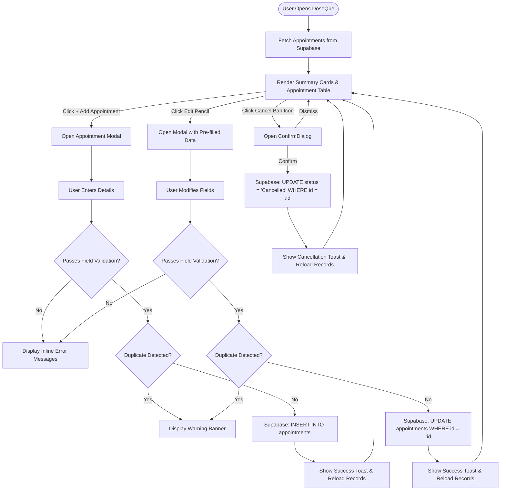

# DoseQue – Healthcare Appointment Management Dashboard

[](https://react.dev/)
[](https://vitejs.dev/)
[](https://tailwindcss.com/)
[](https://supabase.com/)
[](https://lucide.dev/)
[](https://oxc.rs/)
[](LICENSE)

A clinical appointment management dashboard built for healthcare facilities, outpatient clinics, and hospital administrative staff. DoseQue streamlines patient consultation scheduling, monitors clinical workloads across departments, prevents scheduling collisions, and maintains complete historical audit trails using a reactive single-page architecture backed by PostgreSQL via Supabase.

> **Project Context**: Technical Assessment Project for the **Web Development Intern** role at DoseQue.

---

## Table of Contents

- [1. Project Overview](#1-project-overview)
- [2. Technology Stack](#2-technology-stack)
- [3. Project Structure](#3-project-structure)
- [4. Features and Functionalities](#4-features-and-functionalities)
  - [Complete Appointment Lifecycle Workflow](#complete-appointment-lifecycle-workflow)
- [5. Database Design & Supabase Integration](#5-database-design--supabase-integration)
- [6. Validation and Error Handling](#6-validation-and-error-handling)
- [7. Application Screenshots](#7-application-screenshots)
- [8. Technical Decisions & Architectural Rationale](#8-technical-decisions--architectural-rationale)
- [9. Local Setup and Installation](#9-local-setup-and-installation)
- [10. Deployment](#10-deployment)
- [11. Requirements Coverage Matrix](#11-requirements-coverage-matrix)
- [12. Future Improvements](#12-future-improvements)
- [13. Author & Acknowledgments](#13-author--acknowledgments)

---

## 1. Project Overview

### What DoseQue Does
**DoseQue** is an appointment coordination dashboard engineered for clinical care receptionists and medical department supervisors. It offers a centralized interface to register patient consultations, assign attending physicians, track visit statuses, inspect daily consultation loads, search patient records, and update or cancel bookings with clinical audit integrity.

### The Problem It Solves
Traditional clinic intake workflows frequently suffer from:
- **Scheduling Overlaps & Double Bookings**: Patients booked with the same physician for the exact same timeslot.
- **Accidental Record Erasure**: Staff deleting records instead of flagging cancellations, which destroys clinical history and patient visit metrics.
- **Fragmented Data Lookups**: Delaying patient check-in due to slow, unindexed manual records.
- **Cluttered User Interfaces**: Complex hospital management systems that require extensive staff training.

DoseQue addresses these challenges by introducing immediate client-side duplicate collision alerts, strict date and time input validation, non-destructive status updates for cancellations, dynamic physician auto-suggestions, and responsive dual-view data presentation (tabular for desktop, card-based for mobile).

### Primary Users & Target Workflow
- **Clinical Receptionists**: Rapidly search patient appointments, schedule consultations, select doctors from auto-suggested rosters, and make real-time schedule modifications.
- **Practice Coordinators & Clinic Administrators**: Track daily consultation volume via real-time summary indicators (Total, Scheduled, Completed, and Cancelled).
- **Outpatient Care Staff**: View appointment reasons and consult times across desktop workstations, tablets, or mobile devices during patient intake.

---

## 2. Technology Stack

| Layer | Technology | Version | Purpose in DoseQue |
| :--- | :--- | :--- | :--- |
| **Frontend Framework** | React | `^19.3.1` | Component-driven UI architecture, declarative state management with hooks (`useState`, `useEffect`, `useMemo`, `useCallback`), and dynamic DOM reconciliation. |
| **Build Tool & Bundler** | Vite | `^8.3.6` | Next-generation frontend tooling providing rapid Hot Module Replacement (HMR) and optimized Rollup production builds. |
| **React Vite Plugin** | @vitejs/plugin-react | `^6.1.2` | Fast JSX transformation and React Fast Refresh support during local development. |
| **Styling Framework** | Tailwind CSS | `^3.4.17` | Utility-first CSS engine configured with a custom clinical design system, semantic status colors, and responsive layout primitives. |
| **CSS Preprocessing** | PostCSS & Autoprefixer | `^8.5.32` / `^10.6.2` | CSS post-processing pipeline for automated vendor prefixing and browser compatibility. |
| **Iconography** | Lucide React | `^1.72.0` | Accessible, consistent medical and administrative icon set (Stethoscope, Calendar, Clock, Activity, etc.). |
| **Backend & Database** | Supabase JS Client | `^2.119.0` | Communication layer interfacing with Supabase via PostgREST for parameterized CRUD operations over HTTPS. |
| **Database Engine** | PostgreSQL (Supabase) | *Managed* | Relational database hosting the `appointments` relation with ACID transactions, constraints, and audit timestamps. |
| **Static Code Analysis** | Oxlint | `^1.90.0` | High-speed Rust-based JavaScript and React linter ensuring code hygiene and React best practices. |
| **Hosting & CI/CD** | Vercel | *Platform* | Global edge hosting connected to GitHub for automatic continuous deployment upon code commits. |

---

## 3. Project Structure

The project follows a modular, feature-oriented structure separating data communication (`src/lib/`), UI components (`src/components/`), and global state orchestration (`src/App.jsx`):

```text
doseque-appointment-dashboard/
├── public/
│   ├── favicon.svg                  # DoseQue medical cross browser favicon
│   └── icons.svg                    # Public SVG vector sprite definitions
├── src/
│   ├── assets/
│   │   ├── hero.png                 # Static 3D graphical asset
│   │   ├── react.svg                # React project identifier
│   │   └── vite.svg                 # Vite build engine logo
│   ├── components/
│   │   ├── AppointmentForm.jsx      # Create & Edit modal form with validation & duplicate detection
│   │   ├── AppointmentTable.jsx     # Responsive table (desktop) & card view (mobile) with filters
│   │   ├── ConfirmDialog.jsx        # Soft-delete cancellation modal with patient context
│   │   ├── Header.jsx               # Top navigation bar with live date and primary action trigger
│   │   ├── Sidebar.jsx              # Responsive navigation drawer with clinic status badge
│   │   ├── SummaryCards.jsx         # 4-up metric cards displaying live counts by status
│   │   └── Toast.jsx                # Auto-dismissing floating success/error feedback banner
│   ├── hooks/                       # Scaffolded directory for custom reusable hooks
│   ├── lib/
│   │   ├── appointmentService.js    # Data access layer: Supabase PostgREST queries (CRUD)
│   │   └── supabase.js              # Supabase client instantiation and fallback configuration
│   ├── pages/                       # Scaffolded directory for multi-route views
│   ├── App.jsx                      # Root container: global state, data fetching, event orchestration
│   ├── index.css                    # Tailwind base directives and typography font-family setup
│   └── main.jsx                     # Application entry point rendering React DOM root
├── .env.example                     # Environment template defining required Supabase credentials
├── .gitattributes                   # Line ending normalization configuration
├── .gitignore                       # Prevents committing node_modules, build artifacts, and .env
├── .oxlintrc.json                   # Oxlint linting configuration
├── index.html                       # HTML template with Google Fonts preconnect (Inter typeface)
├── package.json                     # Project manifest, dependencies, and NPM scripts
├── postcss.config.js                # PostCSS plugin pipeline configuration
├── tailwind.config.js               # Tailwind design tokens, clinical color palette, and breakpoints
└── vite.config.js                   # Vite configuration with React compiler plugin
```

### Key File Responsibilities

- **`src/App.jsx`**: Coordinates application state. Fetches appointments from Supabase on mount, derives doctor suggestions via `useMemo`, calculates summary card counts, executes filtering and search, and handles modal lifecycles.
- **`src/lib/appointmentService.js`**: Data abstraction layer encapsulating all Supabase database calls (`getAppointments`, `addAppointment`, `updateAppointment`, `cancelAppointment`).
- **`src/lib/supabase.js`**: Initializes the `@supabase/supabase-js` client using `import.meta.env` variables with graceful warnings if environment variables are unconfigured.
- **`src/components/AppointmentForm.jsx`**: Dual-mode modal (Create and Edit). Contains field validations, past-date guards, time formatting, and client-side duplicate checking against loaded appointments.
- **`src/components/AppointmentTable.jsx`**: Renders a 7-column table on viewports $\ge 768\text{px}$ and switches to a card layout on mobile screens ($< 768\text{px}$). Houses the live search bar and status filter pills.
- **`src/components/ConfirmDialog.jsx`**: Guard dialog confirming cancellation intent and informing the user that the record will be soft-cancelled rather than deleted.
- **`src/components/SummaryCards.jsx`**: Visual dashboard summary displaying real-time metrics for Total, Scheduled, Completed, and Cancelled appointments.
- **`src/components/Toast.jsx`**: Accessible notification banner providing instant feedback for CRUD actions with automatic 4.5-second dismissal.

---

## 4. Features and Functionalities

### 1. Central Appointment Dashboard
- Coordinates top-level statistics, dynamic search and filter toolbars, and responsive data views.
- Automatically synchronizes metrics whenever appointments are added, modified, or cancelled.

### 2. Live Dashboard Summary Cards
- Displays four real-time metric counters calculated reactively from database records:
  - **Total Appointments**: Complete count of all records in the database.
  - **Scheduled**: Consultations awaiting patient arrival (`status === 'Scheduled'`).
  - **Completed**: Successfully fulfilled appointments (`status === 'Completed'`).
  - **Cancelled**: Inactive appointments updated to cancelled (`status === 'Cancelled'`).

### 3. Dual-Layout Appointment Listing
- **Desktop/Tablet Table View ($\ge 768\text{px}$)**:
  - Structured 7-column layout: **Patient**, **Doctor**, **Appointment Date**, **Time**, **Reason**, **Status**, and **Actions**.
  - Formats database 24-hour military time (`14:30:00`) into readable 12-hour AM/PM format (`02:30 PM`).
  - Includes patient avatar initials and icon-assisted labels.
- **Mobile Card View ($< 768\text{px}$)**:
  - Adaptive vertical cards showing patient name, doctor, formatted date/time badges, reason overview, status badge, and prominent action buttons.

### 4. Search Functionality
- Real-time client-side search bar filtering by **Patient Name**.
- Case-insensitive substring matching (`searchTerm.toLowerCase()`).
- One-click clear button (`X`) to instantly reset the search query.

### 5. Multi-Tab Status Filtering
- Instant category switching via toolbar pills: **All**, **Scheduled**, **Completed**, and **Cancelled**.
- Integrates seamlessly with active search queries without requiring additional database roundtrips.

### 6. Dynamic Doctor Suggestions (Task 1)
- The doctor input field features an HTML `<datalist id="doctor-suggestions">` dynamically populated from unique doctor names present in the database:
  ```javascript
  const doctorSuggestions = useMemo(() => {
    const doctors = appointments
      .map((apt) => apt.doctor_name?.trim())
      .filter(Boolean)
    return [...new Set(doctors)].sort()
  }, [appointments])
  ```
- Users can click an existing doctor from the dropdown or freely type a new doctor's name, providing both guidance and flexibility.

### 7. Appointment Creation Workflow
- Launched via the **`+ Add Appointment`** button in the header.
- Automatically pre-fills the appointment date with today's date (`YYYY-MM-DD`) and sets a default time of `10:00 AM`.
- Validates all fields and verifies that no identical appointment exists before sending an `INSERT` payload to Supabase.

### 8. Inline Appointment Editing
- Triggered by clicking the **Pencil icon** on any appointment row or card.
- Populates the modal with the record's current values (`patient_name`, `doctor_name`, `appointment_date`, `appointment_time`, `reason`, `status`).
- Modal title dynamically switches to *"Edit Appointment"*, allowing modification of clinical reasons, status updates, or rescheduled dates/times.

### 9. Non-Destructive Appointment Cancellation (Soft Delete)
- Triggered via the **Ban icon** on active appointments.
- **Accurate Implementation Note**: Cancellation does **not** issue a `DELETE` query. It executes a soft status update (`UPDATE appointments SET status = 'Cancelled' WHERE id = :id`).
- When an appointment is already cancelled, the action button is disabled with an explanatory tooltip (`"Appointment is already cancelled"`), preventing redundant requests.
- Preserves complete patient history for reporting and compliance audits.

### 10. Cancellation Confirmation Dialog
- Guards against accidental cancellations through a dedicated alert dialog.
- Explicitly states: *"Are you sure you want to cancel the appointment for [Patient]? This will update the appointment status to Cancelled without deleting the patient record."*
- Features asynchronous state handling with a spinning loader while the Supabase update is in flight.

### 11. Form Validation (Task 2)
- Detailed validation rules run on form submission, halting invalid submissions and displaying inline red error messages:
  - Patient Name: Required, minimum 2 characters, non-whitespace.
  - Doctor Name: Required, minimum 2 characters, non-whitespace.
  - Appointment Date: Required, cannot be set in the past (with an exception for unmodified existing dates during edit mode).
  - Appointment Time: Required, validated against an `HH:MM` time regular expression.
  - Reason for Visit: Required, minimum 3 characters descriptive text.
  - Status: Must match one of `['Scheduled', 'Completed', 'Cancelled']`.

### 12. Duplicate Appointment Collision Detection (Task 3)
- Evaluates the proposed appointment against loaded records prior to submission:
  - Compares normalized `patient_name`, `doctor_name`, `appointment_date`, and `appointment_time` (HH:MM).
  - Excludes the current record ID when editing an existing appointment.
  - If a collision is found, prevents database mutation and renders an amber warning banner:
    > **Duplicate Appointment Warning**: An appointment is already scheduled for [Patient] with [Doctor] on [Date] at [Time].

### 13. Comprehensive Loading, Error, and Empty States (Task 4)
- **Loading State**: Animated spinner with contextual messaging during initial database load, form submission, and cancellation.
- **Error State**: Red banner displayed if Supabase connection fails, equipped with an inline **"Retry"** button that re-invokes `loadAppointments()`.
- **Empty State**: Clear search illustration and prompt displayed when no appointments match active filters or search terms.

### 14. Toast Feedback System
- Non-blocking notification banner in the bottom-right corner.
- Green check badge for successful schedule creation, updates, and cancellations.
- Red warning badge for database or network failures with error message propagation.
- Auto-dismisses after 4.5 seconds or immediately via manual close button.

### 15. Responsive Architecture
- Collapsible sidebar drawer with mobile overlay backdrop on small screens.
- Horizontal scroll preservation for desktop data tables on medium tablet displays.
- Full transformation to compact, touch-friendly card layouts on mobile viewports.

---

### Complete Appointment Lifecycle Workflow



---

## 5. Database Design & Supabase Integration

### Architecture Overview
DoseQue connects directly from the React frontend to a cloud-hosted **PostgreSQL** database managed by **Supabase**. Communication is handled via `@supabase/supabase-js`, which translates client calls into PostgREST API requests over secure HTTPS.

### Schema Definition (`appointments` table)

| Column Name | PostgreSQL Data Type | Constraints & Defaults | Description |
| :--- | :--- | :--- | :--- |
| `id` | `BIGINT` or `UUID` | `PRIMARY KEY`, `GENERATED BY DEFAULT AS IDENTITY` | Unique identifier for each appointment record. |
| `patient_name` | `TEXT` | `NOT NULL` | Full name of the patient receiving clinical consultation. |
| `doctor_name` | `TEXT` | `NOT NULL` | Full name of the assigned attending doctor or specialist. |
| `appointment_date`| `DATE` | `NOT NULL` | Calendar date of consultation (`YYYY-MM-DD`). |
| `appointment_time`| `TIME` | `NOT NULL` | Time of appointment in 24-hour military format (`HH:MM:SS`). |
| `reason` | `TEXT` | `NOT NULL` | Clinical description or symptoms for the visit. |
| `status` | `VARCHAR(20)` | `NOT NULL`, `DEFAULT 'Scheduled'` | Lifecycle state: `'Scheduled'`, `'Completed'`, or `'Cancelled'`. |
| `created_at` | `TIMESTAMPTZ` | `DEFAULT NOW()` | Timestamp marking when the record was created. |

### Supabase SQL DDL Schema Migration Script

To reproduce this table in your Supabase project, execute the following script in the **Supabase SQL Editor**:

```sql
-- 1. Create the appointments table
CREATE TABLE IF NOT EXISTS appointments (
  id BIGINT GENERATED BY DEFAULT AS IDENTITY PRIMARY KEY,
  patient_name TEXT NOT NULL,
  doctor_name TEXT NOT NULL,
  appointment_date DATE NOT NULL,
  appointment_time TIME NOT NULL,
  reason TEXT NOT NULL,
  status VARCHAR(20) NOT NULL DEFAULT 'Scheduled' CHECK (status IN ('Scheduled', 'Completed', 'Cancelled')),
  created_at TIMESTAMPTZ DEFAULT NOW()
);

-- 2. Create performance indexes for common queries
CREATE INDEX IF NOT EXISTS idx_appointments_date_time ON appointments (appointment_date, appointment_time);
CREATE INDEX IF NOT EXISTS idx_appointments_status ON appointments (status);
CREATE INDEX IF NOT EXISTS idx_appointments_patient ON appointments (patient_name);

-- 3. Insert realistic seed data for assessment testing
INSERT INTO appointments (patient_name, doctor_name, appointment_date, appointment_time, reason, status)
VALUES
  ('Eleanor Vance', 'Dr. Sarah Jenkins', CURRENT_DATE, '09:00:00', 'Annual comprehensive physical examination', 'Scheduled'),
  ('Marcus Sterling', 'Dr. Robert Chen', CURRENT_DATE, '10:30:00', 'Follow-up cardiology consultation & ECG review', 'Scheduled'),
  ('Clara Oswald', 'Dr. Sarah Jenkins', CURRENT_DATE, '11:15:00', 'Type 2 diabetes blood glucose monitoring', 'Completed'),
  ('David Kim', 'Dr. Emily Patel', CURRENT_DATE + INTERVAL '1 day', '14:00:00', 'Pediatric vaccination & seasonal allergy review', 'Scheduled'),
  ('Sophia Martinez', 'Dr. Robert Chen', CURRENT_DATE + INTERVAL '2 day', '15:30:00', 'Hypertension management and prescription refill', 'Scheduled'),
  ('James Wilson', 'Dr. Michael Taylor', CURRENT_DATE - INTERVAL '1 day', '08:45:00', 'Orthopedic knee assessment post-MRI scan', 'Completed'),
  ('Rachel Green', 'Dr. Emily Patel', CURRENT_DATE - INTERVAL '2 day', '13:00:00', 'Acute migraine and tension headache evaluation', 'Cancelled');
```

### Frontend-to-Database CRUD Operations

All database interactions are centralized in `src/lib/appointmentService.js`:

```javascript
// READ: Fetch all appointments ordered by date and time
export async function getAppointments() {
  const { data, error } = await supabase
    .from('appointments')
    .select('*')
    .order('appointment_date', { ascending: true })
    .order('appointment_time', { ascending: true })
  if (error) throw new Error(error.message)
  return data || []
}

// CREATE: Insert a new validated appointment
export async function addAppointment(appointment) {
  const { data, error } = await supabase
    .from('appointments')
    .insert([appointment])
    .select()
    .single()
  if (error) throw new Error(error.message)
  return data
}

// UPDATE: Modify appointment fields by ID
export async function updateAppointment(id, updates) {
  const { data, error } = await supabase
    .from('appointments')
    .update(updates)
    .eq('id', id)
    .select()
    .single()
  if (error) throw new Error(error.message)
  return data
}

// CANCEL: Soft-update status to 'Cancelled' (No DELETE)
export async function cancelAppointment(id) {
  const { data, error } = await supabase
    .from('appointments')
    .update({ status: 'Cancelled' })
    .eq('id', id)
    .select()
    .single()
  if (error) throw new Error(error.message)
  return data
}
```

---

## 6. Validation and Error Handling

DoseQue implements client-side validation, duplicate prevention, and user-friendly error boundaries.

### Validation Matrix

| Field | Validation Rules | Error Message Displayed | Handling Mechanism |
| :--- | :--- | :--- | :--- |
| **`patient_name`** | Required; non-empty after trimming; minimum 2 characters. | *"Patient name is required."* / *"Patient name must be at least 2 characters."* | Highlighted input border in red; error message rendered beneath field. |
| **`doctor_name`** | Required; non-empty after trimming; minimum 2 characters. | *"Doctor name is required."* / *"Doctor name must be at least 2 characters."* | Suggests doctors from `<datalist>`, allows custom input, highlights border in red if invalid. |
| **`appointment_date`** | Required; cannot be earlier than today (`YYYY-MM-DD`). | *"Appointment date is required."* / *"Appointment date cannot be in the past."* | HTML5 date picker constrained with `min={todayStr}` for new records; logic permits preserving historical dates when editing existing records. |
| **`appointment_time`** | Required; must match 24-hour time pattern `^([01]\d\|2[0-3]):[0-5]\d(:[0-5]\d)?$`. | *"Appointment time is required."* / *"Please enter a valid appointment time."* | Ensures valid time structure; appends `:00` seconds upon payload construction. |
| **`reason`** | Required; non-empty after trimming; minimum 3 characters. | *"Reason for visit is required."* / *"Please provide a descriptive reason for the visit."* | Multiline textarea with red border feedback and character threshold check. |
| **`status`** | Required; enum constraint (`Scheduled`, `Completed`, `Cancelled`). | *"Status must be Scheduled, Completed, or Cancelled."* | Dropdown selection preventing unexpected arbitrary string inputs. |

### Duplicate Collision Logic (Task 3)
Before dispatching an insert or update query to Supabase, DoseQue runs a collision check across active records:
```javascript
const checkForDuplicate = (trimmedPayload) => {
  const normPatient = trimmedPayload.patient_name.toLowerCase()
  const normDoctor = trimmedPayload.doctor_name.toLowerCase()
  const normDate = trimmedPayload.appointment_date
  const normTime = trimmedPayload.appointment_time.slice(0, 5)

  return existingAppointments.some((apt) => {
    // In edit mode, exclude the record currently being modified
    if (isEdit && initialData?.id && apt.id === initialData.id) return false

    return (
      (apt.patient_name || '').trim().toLowerCase() === normPatient &&
      (apt.doctor_name || '').trim().toLowerCase() === normDoctor &&
      (apt.appointment_date || '').trim() === normDate &&
      (apt.appointment_time || '').slice(0, 5) === normTime
    )
  })
}
```
If a collision occurs, submission is prevented, preserving database consistency and displaying an amber warning alert.

### Error Handling & Recovery (Task 4)
- **Database Connection Failures**: If Supabase credentials are missing or the database is temporarily unreachable, an inline alert displays the error with a **"Retry"** button to re-attempt fetching.
- **Form Submission Errors**: If Supabase rejects a mutation, the modal displays a dedicated error banner without closing, allowing the user to make corrections without losing entered data.
- **Dynamic Field Error Clearing**: As soon as a user starts typing in an invalid field, the field-specific error message clears immediately.

---

## 7. Application Screenshots

This section presents the actual user interface and key workflows of the DoseQue dashboard.

> **Note**: Screenshot images are located in the [`screenshots/`](screenshots/) directory.

### 1. Main Dashboard Overview
*The primary operational interface displaying summary metrics, search bar, status tabs, and appointment records.*


---

### 2. Appointment Data Table & Live Status
*The desktop tabular view displaying patient details, attending physicians, consultation schedules, status badges, and action triggers.*


---

### 3. Add Appointment Modal with Dynamic Doctor Suggestions
*Modal showing the appointment creation form with date validation and dynamic doctor suggestions populated from database records.*


---

### 4. Edit Appointment Modal
*Inline editing view pre-populated with appointment details for schedule adjustments and clinical updates.*


---

### 5. Duplicate Appointment Collision Alert
*Proactive warning banner triggered when attempting to book the same patient with the same doctor at an identical date and time.*


---

### 6. Search and Multi-Tab Filtering
*Real-time search filtering by patient name alongside status tab isolation (Scheduled, Completed, Cancelled).*


---

### 7. Soft Cancellation Confirmation Dialog
*Safety confirmation dialog verifying cancellation intent while explaining that records are retained for auditing purposes.*


---

### 8. Mobile Responsive Layout
*Adaptive card-based layout designed for mobile smartphones and clinical tablets.*


---

## 8. Technical Decisions & Architectural Rationale

### 1. React 19 & Vite 8
- **Why React 19**: Provides efficient declarative state management and component reusability. The application's complex interactive states (modal forms, search filters, live calculations, and toast alerts) benefit from React's reactive paradigm.
- **Why Vite**: Delivers instant Hot Module Replacement (HMR) and optimized Rollup production builds, resulting in a fast developer workflow and a lean production bundle.

### 2. Supabase & Managed PostgreSQL
- **Why Supabase**: Eliminates the overhead of developing and hosting a dedicated Express/Node REST API server for standard CRUD operations. PostgREST handles data access via HTTPS, allowing rapid full-stack iteration.
- **Relational Integrity**: PostgreSQL provides schema validation, data type enforcement (`DATE`, `TIME`), and check constraints (`status IN (...)`), ensuring relational consistency.

### 3. Client-Side Derived State with `useMemo`
- **Why Derived State**: Rather than maintaining redundant state slices for filtered lists, doctor suggestions, and summary counts (which risks out-of-sync bugs), DoseQue computes these values reactively using `useMemo`:
  - `doctorSuggestions` recalculates only when `appointments` changes.
  - `summaryCounts` derives directly from `appointments`.
  - `filteredAppointments` evaluates reactively against `searchTerm` and `statusFilter`.
- **Result**: Zero data discrepancies, immediate UI updates, and zero unnecessary network requests when filtering.

### 4. Soft Status Cancellation vs. Permanent Deletion
- **Why Soft Delete**: In medical and healthcare environments, deleting patient consultation records is a compliance risk that destroys clinical history.
- **Implementation**: Updating `status` to `'Cancelled'` keeps the patient record accessible for audit logs and historic reporting while updating the UI immediately.

### 5. Tailwind CSS Design System
- **Why Tailwind**: Provides a zero-runtime CSS footprint with utility classes. A custom color palette was configured in `tailwind.config.js` (`#3979C9` clinical blue, `#18324F` navy text, `#EBF2FA` soft blue surfaces, and semantic status shades), ensuring visual consistency across all components.

---

## 9. Local Setup and Installation

Follow these step-by-step instructions to clone, configure, and run DoseQue locally.

### Prerequisites
- **Node.js**: `v18.0.0` or higher (verified with Node.js v20/v22)
- **Package Manager**: `npm` (comes with Node.js) or `pnpm` / `yarn`
- **Git**: Installed and configured on your machine
- **Supabase Account**: A free account at [supabase.com](https://supabase.com)

---

### Step 1: Clone the Repository
Open your terminal and clone the repository:

```bash
git clone https://github.com/Shruti-Bhunde/doseque-appointment-dashboard.git
cd doseque-appointment-dashboard
```

---

### Step 2: Install Dependencies
Install all required project packages:

```bash
npm install
```

---

### Step 3: Configure Environment Variables
Create a local `.env` file in the root directory by copying the example template:

**On macOS / Linux:**
```bash
cp .env.example .env
```

**On Windows (PowerShell):**
```powershell
Copy-Item .env.example .env
```

Open `.env` in your code editor and populate your Supabase credentials:

```env
# Supabase Configuration
VITE_SUPABASE_URL=https://your-project-id.supabase.co
VITE_SUPABASE_ANON_KEY=your-anon-public-key-here
```

#### Where to Find Your Supabase Credentials:
1. Log in to [Supabase Dashboard](https://supabase.com/dashboard).
2. Open your project (or create a new one).
3. Navigate to **Project Settings** (gear icon) $\rightarrow$ **API**.
4. Copy the **Project URL** and paste it as `VITE_SUPABASE_URL`.
5. Copy the **Project API Keys $\rightarrow$ `anon` / `public`** key and paste it as `VITE_SUPABASE_ANON_KEY`.

> [!WARNING]
> Never commit your `.env` file or publish Supabase service role keys to GitHub. The `.gitignore` file is pre-configured to exclude `.env`.

---

### Step 4: Initialize the Supabase Database Table
1. In your Supabase dashboard, click **SQL Editor** in the left sidebar.
2. Click **New Query**.
3. Paste the [Supabase SQL DDL Schema Migration Script](#supabase-sql-ddl-schema-migration-script) from Section 5.
4. Click **Run**.
5. Navigate to the **Table Editor** to confirm the `appointments` table and seed records are active.

---

### Step 5: Start the Local Development Server
Launch the Vite development server:

```bash
npm run dev
```

The terminal will display the active local URL (typically `http://localhost:5173/`). Open this URL in your web browser to view DoseQue.

---

### Step 6: Available NPM Scripts

| Command | Action |
| :--- | :--- |
| `npm run dev` | Starts Vite local development server with Hot Module Replacement (HMR). |
| `npm run build` | Compiles and bundles production-ready assets into the `dist/` directory. |
| `npm run preview` | Locally serves the production build from `dist/` for pre-deployment testing. |
| `npm run lint` | Runs the high-performance Oxlint linter across JavaScript and JSX files. |

---

## 10. Deployment

DoseQue is configured for zero-configuration continuous deployment on **Vercel**.

### Vercel Deployment Process

1. **Connect GitHub Repository**:
   - Log in to [Vercel](https://vercel.com) and click **Add New... $\rightarrow$ Project**.
   - Select and import the `doseque-appointment-dashboard` repository.

2. **Configure Build Settings**:
   - **Framework Preset**: `Vite`
   - **Build Command**: `npm run build`
   - **Output Directory**: `dist`
   - **Install Command**: `npm install`

3. **Configure Environment Variables in Vercel**:
   - In the **Environment Variables** section of the deployment setup, add:
     - `VITE_SUPABASE_URL`: Your Supabase Project URL.
     - `VITE_SUPABASE_ANON_KEY`: Your Supabase public anonymous key.
   - Select environments: **Production**, **Preview**, and **Development**.

4. **Deploy**:
   - Click **Deploy**. Vercel will install dependencies, compile the production bundle, and deploy the application to its global edge network.

### Live Application Link
- **Production URL**: [https://doseque-appointment-dashboard.vercel.app](https://doseque-appointment-dashboard.vercel.app) *(or your specific Vercel deployment URL)*
- **GitHub Repository**: [https://github.com/Shruti-Bhunde/doseque-appointment-dashboard](https://github.com/Shruti-Bhunde/doseque-appointment-dashboard)

---

## 11. Requirements Coverage Matrix

This matrix maps each technical assessment requirement to its concrete implementation in the codebase:

| Assessment Requirement | Implemented Feature | Primary Component / File | Verification & Implementation Detail |
| :--- | :--- | :--- | :--- |
| **Core: Dashboard Overview** | Appointment dashboard with summary metrics | `src/App.jsx`, `src/components/SummaryCards.jsx` | Calculates real-time counts for Total, Scheduled, Completed, and Cancelled appointments from Supabase records. |
| **Core: Appointment Listing** | Responsive data table and mobile card view | `src/components/AppointmentTable.jsx` | Displays all appointment records with 12h time formatting, patient avatar initials, and status indicators. |
| **Core: Appointment Creation** | Modal form to schedule new patient visits | `src/components/AppointmentForm.jsx`, `src/lib/appointmentService.js` | Modal pre-populates today's date, runs field validations, checks for duplicate bookings, and executes Supabase `insert()`. |
| **Core: Appointment Editing** | In-place record editing | `src/components/AppointmentForm.jsx`, `src/lib/appointmentService.js` | Clicking edit opens the form pre-filled with existing data; submits an `update()` query targeting the appointment `id`. |
| **Core: Appointment Cancellation** | Safe cancellation workflow | `src/components/ConfirmDialog.jsx`, `src/lib/appointmentService.js` | Prompts user with a confirmation modal; updates `status = 'Cancelled'` without deleting the row from PostgreSQL. |
| **Core: Search & Filter** | Instant patient search and status filtering | `src/components/AppointmentTable.jsx`, `src/App.jsx` | Case-insensitive search by patient name; multi-tab filtering for All, Scheduled, Completed, and Cancelled. |
| **Task 1: Dynamic Doctor Suggestions** | Auto-suggest doctors from database | `src/App.jsx`, `src/components/AppointmentForm.jsx` | Extracts unique doctor names from active appointments via `useMemo` and binds them to an HTML `<datalist>`. |
| **Task 2: Form Validation** | Comprehensive input validation rules | `src/components/AppointmentForm.jsx` | Validates patient/doctor name length, restricts past dates, verifies `HH:MM` time formats, and enforces non-empty reasons. |
| **Task 3: Duplicate Warning** | Proactive booking collision alerts | `src/components/AppointmentForm.jsx` | Checks for matching patient, doctor, date, and timeslot; renders an amber warning banner and halts submission. |
| **Task 4: Error & Loading States** | Loading spinners, error banners, and toast alerts | `src/App.jsx`, `src/components/Toast.jsx`, `src/components/AppointmentTable.jsx` | Loading spinners on table and modals; error notice with **Retry** button on network failure; auto-dismissing toast alerts. |
| **Database Integration** | Cloud PostgreSQL connectivity | `src/lib/supabase.js`, `src/lib/appointmentService.js` | Modular Supabase client performing PostgREST queries over HTTPS with fallback error notices. |
| **Responsive Design** | Desktop, tablet, and mobile layouts | `src/components/Sidebar.jsx`, `src/components/AppointmentTable.jsx`, `tailwind.config.js` | Drawer sidebar with overlay on mobile; adaptive layout switching between tabular view and stacked card view. |

---

## 12. Future Improvements

While the current implementation fulfills all assessment requirements, the following features represent realistic next steps for a production deployment:

1. **Role-Based Authentication (RBAC)**:
   - Integrate Supabase Auth to provide dedicated login portals for Receptionists (read/write), Doctors (view own schedule & mark completed), and System Administrators.
2. **Real-Time Supabase Subscriptions**:
   - Utilize Supabase Realtime (`supabase.channel('appointments')`) to update the dashboard instantly when another staff member schedules or cancels an appointment.
3. **Calendar / Week Schedule View**:
   - Add a full-width interactive calendar or schedule grid (e.g., using FullCalendar) allowing drag-and-drop appointment rescheduling.
4. **Automated Patient Reminders**:
   - Integrate edge functions with Twilio or Resend to send automated SMS and email reminders to patients 24 hours prior to their appointment.
5. **Pagination or Virtualized Scrolling**:
   - Implement server-side pagination (`.range(start, end)`) or windowed virtualization (`tanstack-virtual`) for clinics managing thousands of appointments.
6. **Export Reporting**:
   - Provide one-click export of filtered appointment views to CSV or PDF for clinical audits and departmental handoffs.

---

## 13. Author & Acknowledgments

- **Developer**: [Shruti Bhunde](https://github.com/Shruti-Bhunde)
- **Role**: Technical Assessment for Web Development Intern
- **Repository**: [https://github.com/Shruti-Bhunde/doseque-appointment-dashboard](https://github.com/Shruti-Bhunde/doseque-appointment-dashboard)
- **Framework & Libraries**: React, Vite, Tailwind CSS, Supabase, Lucide React, Oxlint, and Vercel.
